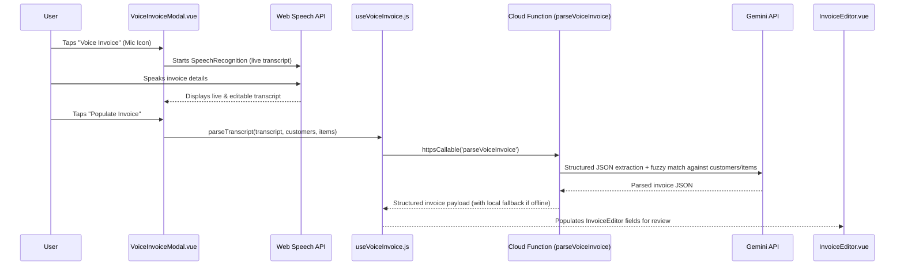

# Voice Invoice Creation

## Goal
Allow users on mobile and desktop to create and pre-fill an invoice in one shot using spoken natural language commands, with AI fuzzy-matching against their existing Customers and Catalog Items, respecting the 3 invoices/month Free Starter limit.

## Architecture Flow

## Tasks
- [x] Task 1: Create `functions/parseVoiceInvoice.js` and export `parseVoiceInvoice` in `functions/index.js` using `GEMINI_API_KEY` to extract client details, line items, dates, tax/discount, and fuzzy-match existing customers/catalog items → Verify: `node -e "require('./functions/parseVoiceInvoice')"` loads cleanly without syntax errors.
- [x] Task 2: Create `src/composables/useVoiceInvoice.js` with Web Speech API (`SpeechRecognition` / `webkitSpeechRecognition`) mobile-safe recording, Cloud Function invocation, and client-side fuzzy-matching fallback → Verify: Composable exports speech state and `parseVoiceCommand`.
- [x] Task 3: Create `src/components/VoiceInvoiceModal.vue` with a mobile-first glassmorphic UI, pulsing mic button (`>=64px` touch target), live waveform animation, sample voice prompts, and editable transcript field → Verify: Modal opens, records/accepts input, and emits parsed invoice data.
- [x] Task 4: Integrate `VoiceInvoiceModal` and voice prefill into `src/components/InvoiceEditor.vue`, `src/components/MobileBottomNav.vue`, and `src/components/Dashboard.vue` (enforcing the 3-invoice/month free plan limit check) → Verify: `npm run build` succeeds with zero errors.

## Done When
- [x] Users can tap "Voice Invoice" (with mic icon) from Mobile Quick Actions, Dashboard, or Invoice Editor, speak a one-shot invoice command, and have the parsed result (with fuzzy-matched customer and catalog items) populate the Invoice Editor for review.
- [x] Free tier 3 invoices/month limit is respected before creating a voice invoice.
- [x] `npm run build` completes cleanly with no errors.
